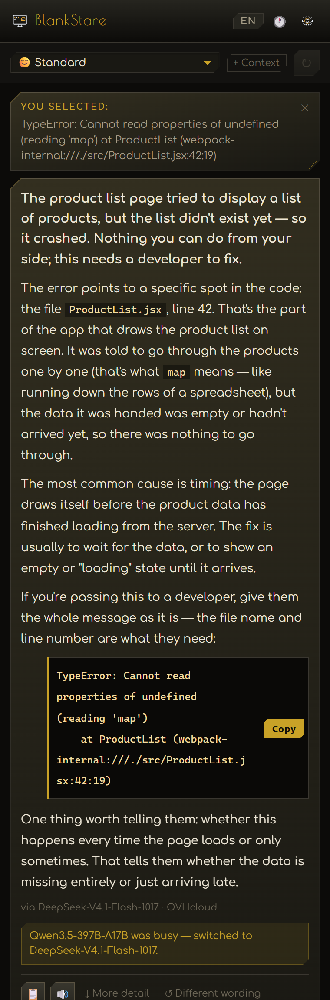
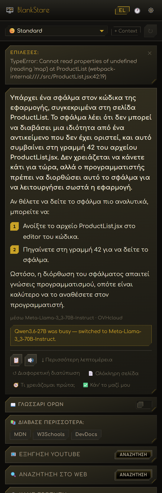
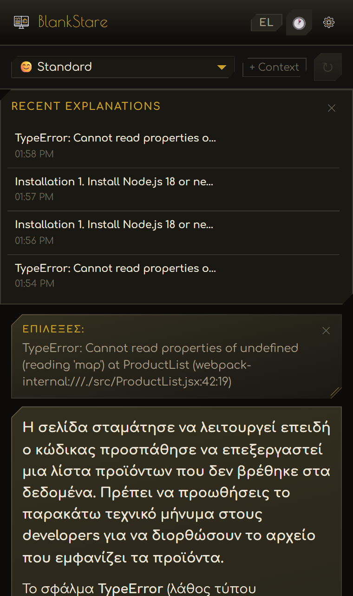
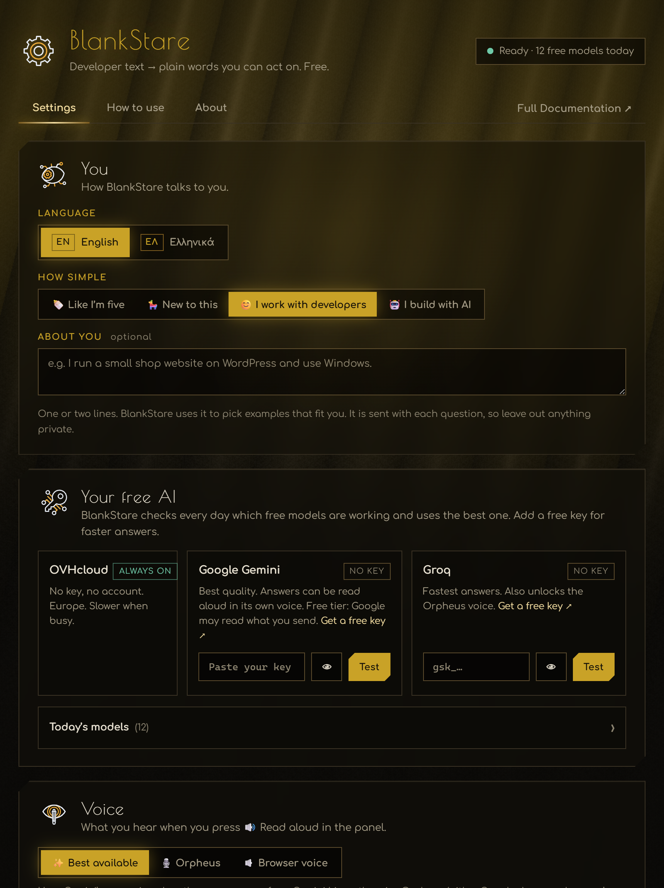

# BlankStare: developer docs and error messages in plain English

**A free Chrome extension that rewrites error messages, READMEs, terminal output and tech jargon into plain English or Greek, in a side panel, while you read.**

📖 **Docs site:** https://docs.stravelakis.com/BlankStare-Dev-English-to-English/ (in Dev, plain English, or ELI5)

## The problem

You're building something with Claude Code, Cursor or ChatGPT, and it hands you
an error you can't read. Or a setup guide that assumes a computer-science
degree. You paste it into a chat, lose your place, and still get an answer
full of the same jargon.

## What it does

- **Rewrites, doesn't annotate.** Select the confusing text; read a plain
  version you can act on, instead of the original.
- **Pitched at you.** Four reading levels, from ELI5 to "I build with AI
  tools", switchable with one click.
- **English or Greek.** The panel, the answers and the read-aloud voice.
- **Names the jargon.** Every technical term with a short meaning.
- **Works with no key at all.** Out of the box it uses OVHcloud's anonymous
  AI endpoint (in Europe, free, slower when busy). You can add a free Google
  Gemini key (best quality) or a free Groq key (fastest). No card or billing
  for either.
- **Fixes itself.** Once a day it checks which free models still work and
  builds a ranked list. A model that is gone is skipped; a busy one rests a
  minute; a refused key is set aside for the day.
- **Asks for little.** The text you select goes to whichever AI answers
  (OVHcloud, Google or Groq). It also reads a public model list from
  [The Nein](https://stravelakis.com/project/the-nein/). Your keys stay in
  Chrome's sync storage.

Also: paste a screenshot (Ctrl+V) to have it explained, "What do I need
first?", a "Do it with me" checklist, commands in copy boxes, "More detail",
"Different wording", full-page summary, follow-up questions, a term glossary,
read aloud, videos and a web search link, the last 20 answers, a list of sites
to stay quiet on, and keyboard shortcuts (Alt+Shift+B opens the panel,
Alt+Shift+E queues the selection).

## Quick start

1. Download this repo and unzip it.
2. `chrome://extensions` → switch on **Developer mode** → **Load unpacked** →
   pick the folder.
3. Settings opens with a 5-step setup. Pick **Try it now** (no key needed), or
   paste a free key from [aistudio.google.com/apikey](https://aistudio.google.com/apikey)
   (Gemini) or [console.groq.com/keys](https://console.groq.com/keys) (Groq).
4. Open the panel (toolbar icon, or Alt+Shift+B). Select any confusing text
   and press the ⚡ button beside it, or right-click → **Explain with
   BlankStare**. The ⚡ button only appears while the panel is open.

Full setup: [INSTALL.md](INSTALL.md) · Full manual: [GUIDE.md](GUIDE.md) ·
Docs site: https://docs.stravelakis.com/BlankStare-Dev-English-to-English/ ·
[Privacy policy](https://docs.stravelakis.com/BlankStare-Dev-English-to-English/privacy/)

## Screenshots

| In Greek | History | Settings |
|---|---|---|
|  |  |  |

The look is **brass on black**: cards with a chamfer on two opposing
corners, brass on near-black. Greek titles are set in GFS Didot and Latin ones
in Poiret One, chosen letter by letter. All fonts ship inside the extension;
nothing loads from Google.

## Status

- **Works:** everything listed above. Automated tests cover the core logic
  (streaming, link safety, language detection, site exclusion).
- **Not yet:** a Chrome Web Store listing.
- **Known rough edge:** Chrome warns that BlankStare can "read and change all
  your data on all websites". The ⚡ button has to be on every page for
  select-to-explain to work; BlankStare only reads your selection.

## For developers

No build step: load the folder and it runs. `npm test` runs the test suite
with Node's own runner, no install needed. `lab/preview.html` shows the panel
without loading the extension, and `cd lab/shoot && npm install && node shoot.mjs` regenerates every
screenshot. Architecture and decisions: [HANDOFF.md](HANDOFF.md). Agents:
[CONNECT-AGENTS.md](CONNECT-AGENTS.md).

## Contributing

Issues and PRs welcome:
[bug report](https://github.com/Stravelakis/BlankStare-Dev-English-to-English/issues/new?template=bug_report.md) ·
[feature idea](https://github.com/Stravelakis/BlankStare-Dev-English-to-English/issues/new?template=feature_request.md).
Please read the [Code of Conduct](CODE_OF_CONDUCT.md). Security problems:
[SECURITY.md](SECURITY.md).

## License

**Source available with attribution**, see [LICENSE](LICENSE). Free for
personal use; forks must credit the original author with a link to
[stravelakis.com](https://stravelakis.com); no commercial use without
permission. Third-party credits in [NOTICE](NOTICE).

## About the creator

BlankStare was built by **Lambros Stravelakis** while building
[skilitsa.com](https://skilitsa.com), with Claude Code and the Hermes agent.
Available for web apps, Chrome extensions and AI tools:
[stravelakis.com](https://stravelakis.com) · lambros@stravelakis.com

If BlankStare saves you time: [ko-fi.com/stravelakis](https://ko-fi.com/stravelakis)
